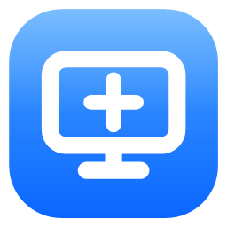
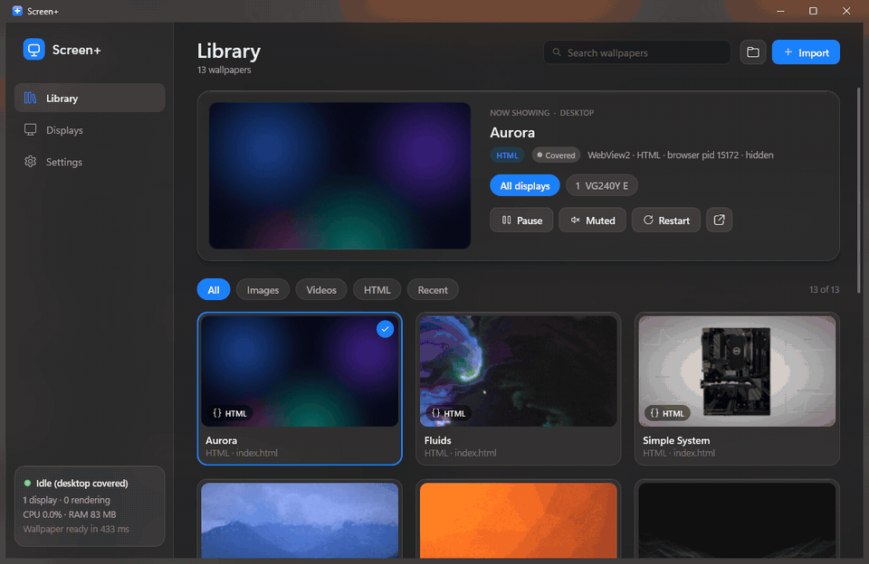

<div align="center">



# Screen+

Live wallpapers for Windows and Linux.

[](https://gitlab.com/screenplus-group/screenplus/-/releases/permalink/latest)
[](LICENSE)

</div>



Screen+ sets videos, GIFs, pictures and web pages as your desktop wallpaper. It is a native app written in C
and pauses rendering when the wallpaper is hidden. Most Lively Wallpaper wallpapers work without changes.

**[Download](https://gitlab.com/screenplus-group/screenplus/-/releases/permalink/latest)** for Windows 10 or 11 (64-bit) and Linux (KDE Plasma 6 or Hyprland).

## Features

- Video, GIF, image and web wallpapers
- Hardware video decoding (H.264, HEVC, VP9, AV1) with a software fallback
- Lively and Wallpaper Engine web and video wallpapers, including audio visualisers
- Wallpapers from YouTube and other video links
- A store that searches seven wallpaper sites at once
- Per-monitor wallpapers, or one wallpaper duplicated or spanned across monitors
- Screensaver mode
- Make wallpaper cooler: turns a picture or video into a 3D wallpaper that follows the mouse, and makes the sky,
  water and plants in a picture move
- Colour grading and wallpaper properties, and recordings of your changes that play on a loop
- Upscaling for videos and pictures smaller than the display (Smooth or Sharp)
- Pauses for fullscreen apps, covered desktops, the lock screen and battery power
- App rules: pause while chosen apps are in front, mute while chosen apps use the microphone (calls)
- Starts the moment you sign in, with a still of your wallpaper on screen until it does
- No admin rights needed, portable version available
- Command-line control

## Install

Run `ScreenPlus-Setup-<version>.exe` from the [latest release](https://gitlab.com/screenplus-group/screenplus/-/releases/permalink/latest).
**Default** adds the sample wallpapers and your Lively library; **Clean** starts empty. Installing over an existing
copy updates it and keeps your library.

Installed copies update themselves from GitHub (**Settings > Auto update**). The portable zip does not.

The installer is not code-signed yet, so SmartScreen may warn you: click **More info**, then **Run anyway**.
Web wallpapers need the [WebView2 Runtime](https://go.microsoft.com/fwlink/p/?LinkId=2124703), which is included
with Windows 11.

Silent install: `ScreenPlus-Setup-<version>.exe /S [/DEFAULT | /CLEAN] [/NOURL] [/VCRUN] [/D=<folder>]`

## Usage

- **Library**: import files or a folder, or drag them onto the window. For a web wallpaper, import the folder that
  contains `index.html`. The link button adds a video, image or web page from a URL.
- **Store**: search MotionBGS, Lively, MoeWalls, wallsflow, DesktopHut and Wallhaven. Sites that don't allow
  direct downloads open in your browser.
- **Displays**: choose Independent, Duplicate or Span.
- **Customise**: adjust colours and the wallpaper's own properties. **Make wallpaper cooler** works on pictures and
  videos. Pick a depth model (Depth Anything 2 or 3, Small to Large); each shows how well this PC runs it and how
  long it takes. A model downloads the first time you pick it (100 MB to 1.4 GB). It needs the Visual C++
  Redistributable 14.44 or newer. Motion in pictures uses one more model (238 MB, downloaded once).
  The record button on **Look & colour** or the wallpaper's properties records what you change until you stop it,
  then plays it on a loop; edit it as graphs (speed, smoothing, draw over a line) or delete it.
- **Settings**: startup, screensaver, pausing, app rules, audio and updates.

| Type | Formats |
| --- | --- |
| Video | MP4, M4V, MOV, MKV, WebM, AVI, WMV, MPG, TS, M2TS, GIF |
| Image | JPG, PNG, BMP, GIF, TIFF, WebP, HEIC, AVIF, JXR |
| Web | HTML folders, Lively and Wallpaper Engine web wallpapers |
| Link | [Sites supported by yt-dlp](https://github.com/yt-dlp/yt-dlp/blob/master/supportedsites.md), direct video and image links, web pages |

Application, Unity, Godot and Wallpaper Engine scene wallpapers are not supported.

## Wallpaper API

Web wallpapers get the Lively and Wallpaper Engine APIs: `livelyPropertyListener`, `livelyAudioListener`,
`livelyCurrentTrack`, `livelySystemInformation`, `livelyWallpaperPlaybackChanged`, `wallpaperRegisterAudioListener`
and `wallpaperPropertyListener`. Pages run in WebView2 at `https://wallpaper.screenplus.example/` and receive mouse
input but not keyboard input.

## Command line

```text
screenplus status | list [filter] | displays
screenplus apply <wallpaper> [--display N]
screenplus import <path|link>... | remove <wallpaper>
screenplus pause | resume | next | restart | audio [on|off]
screenplus look | props | settings [set <key> <value>]
screenplus rules [pause|mute add|remove <app>]
screenplus screensaver | update | tools | vcredist
screenplus start | show | hide | stop | logs [-f]
screenplus help [command]
```

Add `--json` for machine-readable output.

## Data

Settings, logs and downloads are stored in `%LOCALAPPDATA%\ScreenPlus`. Set `SCREENPLUS_DATA_DIR` to use a
different folder.

## Linux

KDE Plasma 6 and Hyprland. GNOME isn't supported yet. The window is `screenplus show`; there's no tray or screensaver yet.
Unpack `ScreenPlus-<version>-linux-x86_64.tar.gz`, run `./install.sh`, then:

```bash
screenplus start
screenplus import ~/Videos/rain.mp4 --apply
```

`screenplus help` lists the commands. KDE needs Qt Multimedia, plus Qt WebEngine for web wallpapers. Hyprland needs
GTK 4, gtk4-layer-shell, libmpv and WebKitGTK. The window needs SDL3, Cairo, Pango and ffmpeg. Video links need yt-dlp.

## Building

Requirements: Visual Studio 2022 Build Tools (C++ and Windows SDK), [MSYS2](https://www.msys2.org) UCRT64 with
NASM, and [NSIS 3](https://nsis.sourceforge.io) for the installer.

```bash
scripts/build-ffmpeg.sh    # once, from an MSYS2 UCRT64 shell
```

```bat
build.cmd Release
```

The app and installer are written to `build\`. GitLab CI builds Windows and Linux and releases every push to `main`.

## License

MIT, see [LICENSE](LICENSE). Third-party components are listed in [THIRD_PARTY_NOTICES.md](THIRD_PARTY_NOTICES.md):

- [FFmpeg](https://ffmpeg.org) (LGPL-2.1-or-later, dynamically linked)
- [WebView2 SDK](https://developer.microsoft.com/microsoft-edge/webview2/) (BSD-3-Clause)
- [yt-dlp](https://github.com/yt-dlp/yt-dlp) (Unlicense) and [QuickJS-NG](https://github.com/quickjs-ng/quickjs) (MIT), optional
- SHARP is not included or downloaded. Its weights are Apple's and limited by Apple's licence, so you supply your own
  `.onnx` and are responsible for following that licence.
- [ONNX Runtime](https://github.com/microsoft/onnxruntime) (MIT) and the depth models, each downloaded when it is first
  picked: [Depth Anything V2](https://huggingface.co/onnx-community/depth-anything-v2-small) Small (Apache-2.0), Base and
  Large (CC BY-NC 4.0); [Depth Anything 3](https://huggingface.co/onnx-community/depth-anything-v3-small) Small, Base and
  Large (Apache-2.0); [UperNet ConvNeXt-Tiny](https://huggingface.co/openmmlab/upernet-convnext-tiny) for motion
  (MIT)
- [NSIS](https://nsis.sourceforge.io) for the installer

Wallpapers in the screenshots belong to their authors. Screen+ is not affiliated with Lively Wallpaper, Wallpaper
Engine or the Store's sites.

Built with help from [Claude Code](https://claude.com/claude-code).
