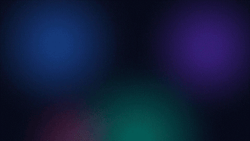

<!-- Repository badges and links for CoolNinja2009/ScreenPlus. -->
<div align="center">


# Screen+

**Live wallpapers for Windows: video, GIF, image and web.<br>Native, light on resources, and compatible with Lively Wallpaper.**

[](https://github.com/CoolNinja2009/ScreenPlus/releases/latest)
[](https://github.com/CoolNinja2009/ScreenPlus/releases)
[](https://github.com/CoolNinja2009/ScreenPlus/actions/workflows/release.yml)


[](LICENSE)

[**Download**](https://github.com/CoolNinja2009/ScreenPlus/releases/latest) &nbsp;·&nbsp; [Features](#features) &nbsp;·&nbsp; [Install](#install) &nbsp;·&nbsp; [Docs](#documentation) &nbsp;·&nbsp; [Build](#build-from-source)

<br>


</div>

## Features

|  |  |
| --- | --- |
| 🎞️ **Every kind of wallpaper** | Videos (MP4, MKV, WebM, MOV, …), animated GIFs, images (JPG, PNG, WebP, HEIC, AVIF, …) and interactive web pages built with HTML, CSS and JavaScript. |
| ⚡ **GPU video decoding** | H.264, HEVC (including 10-bit), VP9, AV1, MPEG-2 and VC-1 decode on the GPU through D3D11VA, with automatic software fallback. |
| 🧩 **Lively Wallpaper compatible** | Your Lively library is picked up automatically, with saved properties, audio visualisers, system information and now playing (title, artist, album art). Wallpaper Engine web and video projects work too. |
| ✨ **A library that moves** | Thumbnails play each wallpaper's preview. Web wallpapers that ship none are recorded into a GIF, the same way Lively does it. |
| 🖥️ **Multi-monitor** | One wallpaper everywhere, or a different one on each display. |
| 🔋 **Gets out of the way** | Pauses for fullscreen games and videos, covered or locked screens and battery power. A renderer that crashes restarts on its own. |
| 🖱️ **Interactive** | Web wallpapers can react to the mouse on the desktop. The keyboard is never shared. |
| 📦 **Friendly installer** | Per-user, no administrator rights. Default or clean install, updates in place, and a real uninstaller. |

## Screenshots

<table>
  <tr>
    <td width="50%"></td>
    <td width="50%"></td>
  </tr>
  <tr>
    <td align="center"><b>Displays</b>: a wallpaper per monitor, or one everywhere</td>
    <td align="center"><b>Settings</b>: start-up, pausing, audio and web options</td>
  </tr>
  <tr>
    <td align="center"></td>
    <td align="center"></td>
  </tr>
  <tr>
    <td align="center"><b>Installer</b>: default, clean, or update in place</td>
    <td align="center"><b>Recorded preview</b> of a web wallpaper</td>
  </tr>
</table>

## Install

1. Download **`ScreenPlus-Setup-<version>.exe`** from the [latest release](https://github.com/CoolNinja2009/ScreenPlus/releases/latest).
2. Run it. No administrator rights are needed; Screen+ installs for your account only.
3. Pick an installation type:
   - **Default** includes the Aurora sample and imports your Lively Wallpaper library.
   - **Clean** starts with an empty library.
4. Open Screen+ from the Start menu or the notification area and choose a wallpaper.

Running the installer again updates an existing installation in place and keeps your library. Every release also has a portable `.zip`.

> [!NOTE]
> The installer is not code-signed yet, so Windows SmartScreen may warn the first time. Choose **More info → Run anyway**.

**Requirements:** 64-bit Windows 10 or 11. Web wallpapers use the Microsoft Edge [WebView2 Runtime](https://go.microsoft.com/fwlink/p/?LinkId=2124703), which comes with Windows 11.

## Documentation

<details open>
<summary><b>Adding wallpapers</b></summary>
<br>

- **Import** adds files or a wallpaper folder. You can also drag files onto the window.
- For a web wallpaper, choose the **whole folder** that contains `index.html`. Screen+ maps the folder into WebView2, so relative CSS, JavaScript, fonts and media keep working. Files are never copied, changed or deleted.
- Lively `LivelyInfo.json` and Wallpaper Engine `project.json` packages are recognised.
- Lively Wallpaper's library is imported automatically at start-up. Turn this off under **Settings › HTML wallpapers**.

| Type | Formats |
| --- | --- |
| Video | MP4, M4V, MOV, MKV, WebM, AVI, WMV, MPG/MPEG, TS/M2TS, animated GIF |
| Image | JPG, PNG, BMP, GIF, TIFF, WebP, HEIC/HEIF, AVIF, JXR (HEIC and AVIF need the Windows codec extensions) |
| Web | HTML folders, Lively web, audio and URL wallpapers, Wallpaper Engine web projects |

Native-app, Unity, Godot and Wallpaper Engine *scene* projects need their original engine and are reported as unsupported.
</details>

<details>
<summary><b>Displays and pausing</b></summary>
<br>

- In the library, **All displays** applies a wallpaper everywhere; choose a monitor, or use the **Displays** page, to give each screen its own.
- Rendering pauses during fullscreen apps, on displays covered by maximised windows, while the PC is locked or the screen is off, and on battery power. Each rule can be switched off in **Settings**.
- Video and web wallpapers are muted until you turn audio on.
</details>

<details>
<summary><b>For wallpaper creators: web API</b></summary>
<br>

Screen+ implements the Lively and Wallpaper Engine web APIs, so existing wallpapers work unchanged.

| API | What the page receives |
| --- | --- |
| `livelyPropertyListener(name, value)` | Values from `LivelyProperties.json`, including Lively's saved customisations |
| `livelyAudioListener(audioArray)` | 128 bands from 0 to 1, captured from the default output device |
| `livelyCurrentTrack(json)` | The Windows media session: title, artist, album and thumbnail (base64) |
| `livelySystemInformation(json)` | Lively system data: cpu/gpu/netcard names, cpu and gpu-3D usage, memory, network speed and battery |
| `livelyWallpaperPlaybackChanged(json)` | `{"IsPaused": true}` while Screen+ pauses the wallpaper |
| `wallpaperRegisterAudioListener(callback)` | Wallpaper Engine audio: 64 left + 64 right values |
| `wallpaperPropertyListener` | Wallpaper Engine `applyUserProperties`, `applyGeneralProperties` and `setPaused` |

Pages run sandboxed in WebView2 at `https://wallpaper.screenplus.example/`. Desktop mouse input is forwarded; the keyboard never is.
</details>

<details>
<summary><b>Command line</b></summary>
<br>

Setup puts `screenplus` on your PATH (`screenplus path add` does it for a copied install). In a terminal it runs
`ScreenPlus.com`, the console twin of `ScreenPlus.exe`, and talks to the running app. Without arguments it opens an
interactive `screen+>` prompt; commands can also be piped in as a script.

```text
screenplus status [--watch]               what runs on each display (--watch: live, Ctrl+C stops)
screenplus list [image|video|html|text]   the library, * = on screen
screenplus apply <name|number|id|path> [--display N]
screenplus import <path>... [--apply]   |   remove <wallpaper>   |   displays
screenplus pause | resume | toggle | next | restart | audio [on|off]
screenplus look [set <key> <value> ... | reset]        brightness contrast saturation hue gamma tint ...
screenplus props [set <name> <value> | reset]          the wallpaper's own Lively / WE settings
screenplus settings [set <key> <value>]
screenplus start [--show] | show | hide | stop
screenplus logs [app|engine] [-n N] [-f]   |   paths   |   path [add|remove]   |   help [command]
```

`--json` prints machine-readable output, e.g. `(screenplus status --json | ConvertFrom-Json).displays`.
Exit codes: 0 ok, 1 command failed, 2 bad usage, 3 Screen+ not running. `screenplus help` lists everything.

```text
ScreenPlus.exe [--tray | --show | --pause | --resume | --toggle-pause | --next | --exit]
```

The executable's own switches also reach the running Screen+; `--next` switches to the next wallpaper.

```text
ScreenPlus-Setup-<version>.exe /S [/DEFAULT | /CLEAN] [/D=<folder>]     silent install (/D must come last)
uninstall.exe /S                                                      silent uninstall
```
</details>

<details>
<summary><b>Files and troubleshooting</b></summary>
<br>

| Location or variable | Purpose |
| --- | --- |
| `%LOCALAPPDATA%\ScreenPlus\config.ini` | Settings and library, plain text (previous version kept as `config.bak`) |
| `%LOCALAPPDATA%\ScreenPlus\logs\` | Logs and crash dumps. Attach them to bug reports |
| `%LOCALAPPDATA%\ScreenPlus\cache\previews\` | Recorded web previews, safe to delete |
| `SCREENPLUS_DATA_DIR` | Use another data folder, e.g. for a portable setup |
| `SCREENPLUS_HWDEC=zerocopy` or `off` | Video decoding mode. Default: GPU decode plus one GPU-side copy per frame |

</details>

## Build from source

You need Visual Studio 2022 Build Tools (C++ workload and Windows SDK), [MSYS2](https://www.msys2.org) (UCRT64) with NASM for FFmpeg, and optionally [NSIS 3](https://nsis.sourceforge.io) for the installer (`winget install NSIS.NSIS`).

Build the LGPL, shared FFmpeg once, from an MSYS2 UCRT64 shell in the repository folder:

```bash
scripts/build-ffmpeg.sh
```

Then build Screen+ and its installer:

```bat
build.cmd Release
```

This produces `build\ScreenPlus.exe` (with the FFmpeg DLLs, licences and the sample wallpaper next to it) and, when NSIS is installed, `build\ScreenPlus-Setup-<version>.exe`. The installer artwork is regenerated with `installer\make-art.ps1`.

## Releases

Every push to `main` that changes the app is built by [GitHub Actions](.github/workflows/release.yml) and published as a new release: the next patch version (`v1.0.3` → `v1.0.4`), or `SCREENPLUS_VERSION` from `CMakeLists.txt` when you raise it there. Pushing a `vX.Y.Z` tag releases exactly that version. Each release carries the installer, a portable zip and SHA-256 checksums. Pull requests are built but not released.

## Roadmap

- [x] Video, image, GIF and web wallpapers with GPU video decoding
- [x] Lively library import, properties, audio visualisers and now playing
- [x] Animated library with recorded previews for web wallpapers
- [x] Installer with default, clean and in-place update
- [ ] Customise panel for wallpaper properties
- [ ] Span one wallpaper across all monitors
- [ ] Pause rules for individual apps
- [ ] Screensaver mode
- [ ] Update notifications inside the app

## License and credits

Screen+ is released under the [MIT License](LICENSE).

- [FFmpeg](https://ffmpeg.org): LGPL-2.1-or-later, dynamically linked. See [THIRD_PARTY_NOTICES.md](THIRD_PARTY_NOTICES.md).
- [Microsoft Edge WebView2](https://developer.microsoft.com/microsoft-edge/webview2/) SDK: BSD-3-Clause.
- The installer is built with [NSIS](https://nsis.sourceforge.io).
- Wallpapers in the screenshots, apart from Aurora, come from [Lively Wallpaper](https://github.com/rocksdanister/lively)'s built-in library and belong to their authors.

Screen+ is an independent project. It is compatible with wallpapers made for Lively Wallpaper and Wallpaper Engine but is not affiliated with either.
