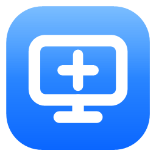
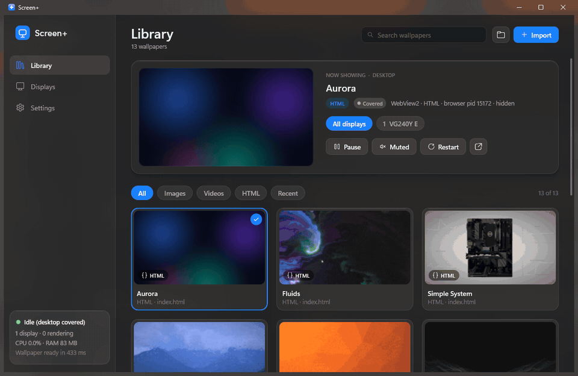
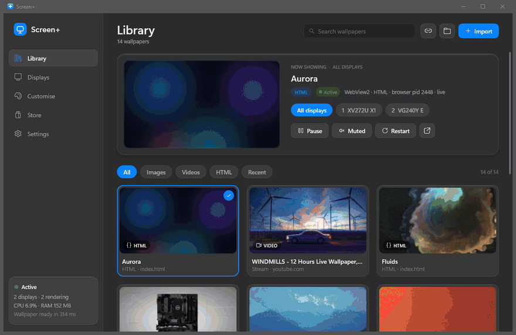
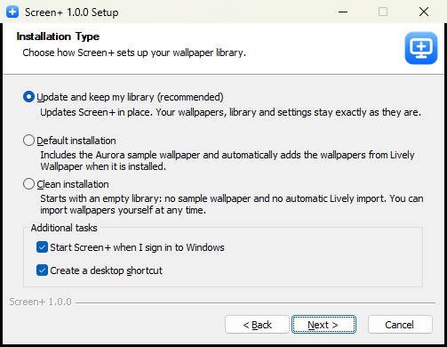
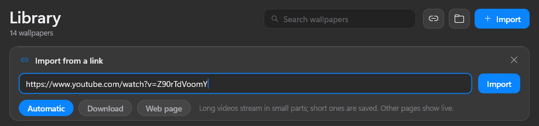
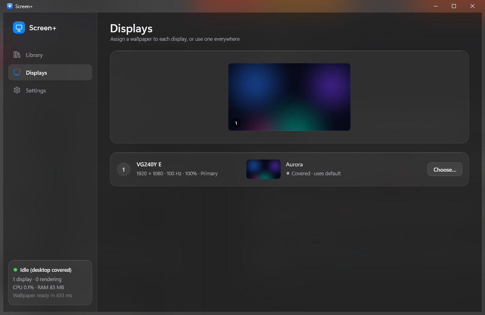
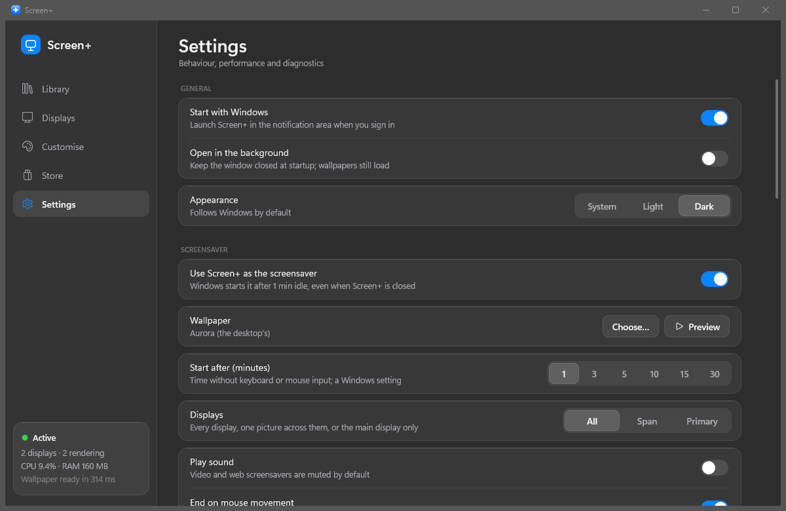

<div align="center">



# Screen+

Live wallpapers for Windows. Videos, GIFs, pictures, web pages and YouTube links,<br>
plus a store that searches six wallpaper sites at once.

[](https://github.com/CoolNinja2009/ScreenPlus/releases/latest)
[](https://github.com/CoolNinja2009/ScreenPlus/releases)
[](LICENSE)

</div>



Screen+ puts videos, GIFs, pictures and web pages on your desktop, behind the icons. It's written in C against
the Win32 API (no Electron, no .NET), and it pauses itself whenever the wallpaper can't be seen. Most wallpapers
made for Lively Wallpaper work in it as they are.

**[Download the latest version](https://github.com/CoolNinja2009/ScreenPlus/releases/latest)**. You need 64-bit Windows 10 or 11.

## Features

- Plays videos (MP4, MKV, WebM, MOV and most others), GIFs, pictures and web pages.
- Video is decoded on the GPU (D3D11VA) for H.264, HEVC including 10-bit, VP9, AV1, MPEG-2 and VC-1, with a
  software fallback.
- Runs Lively web and video wallpapers as they are, including audio visualisers, system info and now playing.
  Wallpaper Engine web and video wallpapers work too.
- Paste a YouTube link and it becomes your wallpaper. Long videos stream, short ones get downloaded once.
- A [store](#store) with live wallpapers and pictures from six sites in one feed.
- A different wallpaper on each monitor, the same one on all of them, or one picture spanned across all of them.
- Can be your Windows screensaver.
- "Make wallpaper cooler" turns a flat picture into a 3D wallpaper that moves with your mouse.
- Per-wallpaper settings and colour grading (brightness, contrast, saturation, hue, gamma, tint).
- Pauses for fullscreen games and videos, covered desktops, the lock screen and battery.
- Installs without admin rights. There's a portable zip too.
- A `screenplus` command for the terminal if you want to script things.

## Store



The Store tab (new in 1.8) shows wallpapers from MotionBGS, Lively, MoeWalls, wallsflow, backiee and Wallhaven
in one feed. The first four have live (video) wallpapers. backiee and Wallhaven have pictures, some of them up to 8K.

The search box searches every site at once, and there are filters for category, resolution, sort order,
live or still, and site. Not every site supports every filter. Sorting only changes the backiee and Wallhaven
results, for example, and asking for 5K or 8K leaves only those two. The same wallpaper is often uploaded to more
than one site, so Screen+ compares the previews and shows just the best copy (the higher resolution one, or the
bigger file if they're the same).

**Download** saves the wallpaper and adds it to your library. MoeWalls and wallsflow don't allow direct downloads
(encrypted links, captchas and download limits), so on their cards the button says **Open on MoeWalls** or
**Open on wallsflow** and takes you to the page in your browser instead. Wallhaven is always searched with
its SFW filter.

There's no account or API key involved. Previews are cached for a week in `%LOCALAPPDATA%\ScreenPlus\cache\store\`.
How each site gets read is written up in [docs/store](docs/store/sources.md).

## Install

1. Download `ScreenPlus-Setup-<version>.exe` from the [latest release](https://github.com/CoolNinja2009/ScreenPlus/releases/latest).
2. Run it. It installs for your account only, so it won't ask for admin.
3. Pick **Default** (comes with the Aurora sample and imports your Lively library) or **Clean** (empty library).
   With Default, leave **Sample wallpapers** ticked to download the other samples too (about 35 MB from GitHub).
4. Leave **Video import from web links** ticked if you want YouTube links to work. Setup then downloads yt-dlp
   and QuickJS-NG, about 20 MB of official releases checked against pinned SHA-256 hashes. You can also turn
   this on later in Settings.
5. Start Screen+ from the Start menu or the tray icon.



If your PC is missing the Visual C++ runtime that "Make wallpaper cooler" needs, the same setup page offers to
install it (about 25 MB from Microsoft, and Windows asks for admin once). Silent installs skip it unless you
pass `/VCRUN`.

Running a newer setup over an old install updates it and keeps your library. Each release also has a portable
zip, which includes the link tools and all the sample wallpapers.

Installed copies update themselves: **Settings > General > Auto update** (on by default) checks GitHub a few
minutes after Screen+ starts and then every 12 hours. A newer release's setup is downloaded, checked against the
SHA-256 GitHub lists for it, and run silently; Screen+ closes for a few seconds and comes back on the new version
with your library and settings. If the window is open, it waits until you close it. **Check now** (or
`screenplus update`) looks right away. The portable zip never updates itself.

> [!NOTE]
> The installer isn't code-signed yet, so SmartScreen will probably warn you the first time.
> Click **More info**, then **Run anyway**.

Web wallpapers need the Microsoft Edge [WebView2 Runtime](https://go.microsoft.com/fwlink/p/?LinkId=2124703).
Windows 11 already has it.

## Using it

### Adding wallpapers

Click **Import** to add files or a wallpaper folder, or drag files onto the window. For a web wallpaper, pick
the folder that has the `index.html` in it rather than the file itself, so its scripts, styles and fonts still
load. Screen+ never copies, moves or changes your files.

Lively packages (`LivelyInfo.json`) and Wallpaper Engine projects (`project.json`) are recognised. If you have
Lively installed, new wallpapers from its library get imported each time Screen+ starts. You can turn that off
under **Settings > HTML wallpapers**.

Every wallpaper in the library plays a small preview of itself. Web wallpapers that don't ship one get a preview
recorded automatically, the same way Lively does it. To rename a wallpaper, double-click its name.

| Type | Formats |
| --- | --- |
| Video | MP4, M4V, MOV, MKV, WebM, AVI, WMV, MPG/MPEG, TS/M2TS, animated GIF |
| Image | JPG, PNG, BMP, GIF, TIFF, WebP, HEIC/HEIF, AVIF, JXR (HEIC and AVIF need the codec extensions from the Microsoft Store) |
| Web | HTML folders, Lively web, audio and URL wallpapers, Wallpaper Engine web projects |
| Link | YouTube and the other [sites yt-dlp supports](https://github.com/yt-dlp/yt-dlp/blob/master/supportedsites.md), direct links to videos and images, live web pages |

Native apps, Unity, Godot and Wallpaper Engine *scene* wallpapers need their own engine, so they show up as
unsupported.

### Wallpapers from links



The link button next to Import takes any web address and has three modes:

- **Automatic** streams long videos, like the 10-hour loops on YouTube, in small pieces through a RAM cache of
  at most 32 MB, and nothing gets saved. Short videos (up to 10 minutes and 300 MB) and images are downloaded
  once instead, which uses less data than streaming the same clip on every loop. A page with no video on it
  becomes a live web wallpaper.
- **Download** always saves the video, so it plays offline.
- **Web page** shows the page itself.

Videos are fetched at your screen's resolution at most, in a format your GPU can decode when there's a choice.
Streaming stops while the wallpaper is paused or covered, and it picks up again if your connection drops.
Screen+ never signs in or sends cookies, so only public videos work. Removing a link wallpaper also deletes its
downloaded copy.

### Multiple monitors



**Displays > Arrangement** has three modes:

- **Independent**: each display can have its own wallpaper. In the library, **All displays** sets the default
  and picking a display gives it its own (so does **Choose...** on the Displays page).
- **Duplicate**: the default wallpaper on every display. A video is decoded once and shown on all of them, frame
  for frame.
- **Span**: one wallpaper across all your displays as if they were one big screen. It's cropped to fill, never
  stretched.

Your per-display picks aren't lost while you use Duplicate or Span. They come back when you switch to
Independent again.

Displays are remembered by their device path, so they keep their wallpapers after a reboot or unplugging. If you
plug a monitor into a different port or dock it usually gets its wallpaper back as well. Resolution, scaling and
orientation changes are picked up without restarting anything. **Identify** shows each display's number on it.

### Pausing

Rendering stops on a display that has a fullscreen app on it (the others keep playing, and in Span the whole
picture freezes), on displays covered by maximised windows, while the PC is locked or the screen is off, while
the screensaver runs, and on battery. Each of these can be switched off in Settings.

Sound is off until you turn it on. If a renderer crashes it gets restarted, up to 3 times, after which you're
back to the normal Windows wallpaper.

### Screensaver



Turn on **Settings > Screensaver > Use Screen+ as the screensaver**. No admin rights needed. By default it shows
whatever is on your desktop. **Choose...** picks a different wallpaper, or right-click one in the library and pick
**Use as screensaver**.

The same section has the idle time, whether it shows on every display, spans them or uses only the main one,
sound, whether moving the mouse ends it (keys, clicks and the wheel always do), and whether Windows shows the
sign-in screen afterwards. **Preview** starts it right away.

It works even when Screen+ isn't running. Setup puts `ScreenPlus.scr` next to the app and Windows starts that
after the idle time, which is also why it's listed in the normal Screen Saver Settings dialog. The desktop
wallpaper pauses while it runs. If it starts on top of a fullscreen game, a presentation or the sign-in screen,
it quits straight away.

Web screensavers don't get audio, system info or now playing data. If your organisation sets the screensaver
through Group Policy, Windows keeps theirs and the Settings page tells you. Uninstalling turns the Screen+
screensaver off, but only if it's the one in use.

### Make wallpaper cooler

Open a picture wallpaper in **Customise** and press **Make wallpaper cooler**. Screen+ runs the Depth Anything V2
model on the picture to work out what's close and what's far away, then turns it into a web wallpaper where the
near parts slide over the far ones when you move the mouse. **Depth strength** and **Auto move** are under
Wallpaper properties, and **Use plain image** undoes it.

Nothing is downloaded until you press the button for the first time. Then it fetches ONNX Runtime and the model
(about 110 MB, checked against pinned SHA-256 hashes) into `%LOCALAPPDATA%\ScreenPlus\depth\`. Each picture
takes a few seconds. On the first run it also times your GPU (through DirectML) against your CPU and keeps
whichever was faster. That result is saved in `depth\backend.json`, so delete it if you want it to test again.

**Settings > HTML wallpapers > Make image wallpapers interactive** does this to every picture you apply. Mouse
movement needs **Allow desktop mouse interaction**, Auto move works without it.

It needs the Visual C++ Redistributable (x64) 14.44 or newer, which most PCs already have. If yours doesn't,
setup offers to install it, or you can run `screenplus vcredist install`.

## For wallpaper makers

Screen+ implements the Lively and Wallpaper Engine web APIs, so existing wallpapers don't need any changes.

| API | What the page gets |
| --- | --- |
| `livelyPropertyListener(name, value)` | Values from `LivelyProperties.json`, including the customisations saved in Lively |
| `livelyAudioListener(audioArray)` | 128 bands from 0 to 1, captured from the default output device |
| `livelyCurrentTrack(json)` | The Windows media session: title, artist, album and thumbnail (base64) |
| `livelySystemInformation(json)` | Lively's system data: CPU, GPU and network card names, CPU and GPU-3D usage, memory, network speed and battery |
| `livelyWallpaperPlaybackChanged(json)` | `{"IsPaused": true}` while Screen+ has the wallpaper paused |
| `wallpaperRegisterAudioListener(callback)` | Wallpaper Engine audio: 64 left + 64 right values |
| `wallpaperPropertyListener` | Wallpaper Engine `applyUserProperties`, `applyGeneralProperties` and `setPaused` |

Pages run sandboxed in WebView2 at `https://wallpaper.screenplus.example/`. Mouse input on the desktop is passed
to the page, keyboard input never is.

## Command line

Setup puts `screenplus` on your PATH (for a copied install, run `screenplus path add`). It runs `ScreenPlus.com`,
the console twin of the app, which talks to the running Screen+. With no arguments you get an interactive
`screen+>` prompt, and you can pipe commands into it as a script.

```text
screenplus status [--watch]                       what's on each display (--watch keeps updating)
screenplus list [filter]                          the library, * = on screen
                                                  filter: image video html lively missing active, or part of a name
screenplus apply <name|number|id|path> [--display N]
screenplus import <path>... [--apply]             add files or folders
screenplus import <link> [--download | --page]    stream or save a video from a link, or add the page
screenplus remove <wallpaper>                     remove from the library (the file stays)
screenplus displays
screenplus pause | resume | toggle | next | restart | audio [on|off]
screenplus look [set <key> <value> ... | reset]   brightness contrast saturation gamma hue tint ...
screenplus props [set <name> <value> | reset]     the wallpaper's own Lively / WE settings
screenplus settings [set <key> <value>]           e.g. settings set display_mode span
screenplus update [check | status]                install a newer release from GitHub now (check: only look)
screenplus screensaver [on | off | preview | timeout <min> | lock on|off | use <wallpaper|desktop>]
screenplus tools [install | remove]               yt-dlp + QuickJS-NG for links
screenplus vcredist [install]                     the Visual C++ runtime for Make wallpaper cooler
screenplus start [--show] | show | hide | stop
screenplus logs [app|engine] [-n N] [-f]  |  paths  |  path [add|remove]  |  help [command]
```

Add `--json` for machine-readable output, e.g. `(screenplus status --json | ConvertFrom-Json).displays`.
Exit codes are 0 ok, 1 the command failed, 2 bad usage, 3 Screen+ isn't running.

The executables take a few switches too. The app's own ones are passed on to the running instance.

```text
ScreenPlus.exe [--tray | --show | --pause | --resume | --toggle-pause | --next | --exit | --screensaver-settings]
ScreenPlus.exe --startup                  how Start with Windows launches it: the window opens unless Open in the background is on
ScreenPlus.exe --screensaver /s           run the screensaver now (same as Preview)
ScreenPlus.scr /s | /p <hwnd> | /c        how Windows starts it: fullscreen, settings preview, its Settings button

ScreenPlus-Setup-<version>.exe /S [/DEFAULT | /CLEAN] [/NOURL] [/VCRUN] [/D=<folder>]   silent install (/D goes last)
uninstall.exe /S                                                                         silent uninstall
```

## Files

Everything lives in `%LOCALAPPDATA%\ScreenPlus\` unless you set `SCREENPLUS_DATA_DIR`.

| Path or variable | What it is |
| --- | --- |
| `config.ini` | Settings and library, plain text. The previous version is kept as `config.bak` |
| `logs\` | Logs and crash dumps (`screenplus.log`, `engine.log`, `screensaver.log`). Please attach these to bug reports |
| `cache\previews\` | Recorded previews of web wallpapers. Safe to delete |
| `cache\store\` | Store previews, kept for a week. Safe to delete |
| `downloads\` | Wallpapers saved from links and the Store. Deleted along with their library entry |
| `tools\` | yt-dlp and QuickJS-NG (`screenplus tools remove` deletes them) |
| `depth\` | ONNX Runtime, the depth model, `backend.json` and one folder per depth wallpaper |
| `WebView2-Screensaver\` | The web screensaver's browser profile. Safe to delete |
| `SCREENPLUS_DATA_DIR` | Use a different data folder, e.g. for a portable setup |
| `SCREENPLUS_HWDEC=zerocopy` or `off` | Video decoding mode. The default is GPU decoding plus one GPU-side copy per frame |

## Building

You'll need the Visual Studio 2022 Build Tools (C++ workload and Windows SDK), [MSYS2](https://www.msys2.org)
(UCRT64) with NASM for FFmpeg, and [NSIS 3](https://nsis.sourceforge.io) if you want the installer
(`winget install NSIS.NSIS`).

Build the LGPL, shared FFmpeg once, from an MSYS2 UCRT64 shell in the repo folder:

```bash
scripts/build-ffmpeg.sh
```

Then build Screen+ and the installer:

```bat
build.cmd Release
```

That gives you `build\ScreenPlus.exe` with the FFmpeg DLLs, licences and sample wallpapers next to it, and
`build\ScreenPlus-Setup-<version>.exe` if NSIS is installed. `installer\make-art.ps1` regenerates the installer
artwork.

Every push to `main` that changes the app is built by [GitHub Actions](.github/workflows/release.yml) and
released as the next patch version (`v1.8.0` becomes `v1.8.1`), or as `SCREENPLUS_VERSION` from `CMakeLists.txt`
when that's higher. Pushing a `vX.Y.Z` tag releases exactly that version. Each release has the installer, the
portable zip and SHA-256 checksums. Pull requests get built but not released.

## Not done yet

- Pause rules for specific apps

## License and credits

Screen+ is MIT licensed, see [LICENSE](LICENSE). It uses:

- [FFmpeg](https://ffmpeg.org) (LGPL-2.1-or-later, dynamically linked). See [THIRD_PARTY_NOTICES.md](THIRD_PARTY_NOTICES.md).
- The [Microsoft Edge WebView2](https://developer.microsoft.com/microsoft-edge/webview2/) SDK (BSD-3-Clause).
- [yt-dlp](https://github.com/yt-dlp/yt-dlp) (Unlicense) and [QuickJS-NG](https://github.com/quickjs-ng/quickjs)
  (MIT), optional. Unmodified official builds, run as separate programs.
- [ONNX Runtime](https://github.com/microsoft/onnxruntime) (MIT) and
  [Depth Anything V2 Small](https://huggingface.co/onnx-community/depth-anything-v2-small) (Apache-2.0), only
  downloaded when you use Make wallpaper cooler.
- [NSIS](https://nsis.sourceforge.io) for the installer.

The wallpapers in the screenshots, apart from Aurora, come from [Lively Wallpaper](https://github.com/rocksdanister/lively)'s
built-in library, and the ones in the Store recording come from the sites listed above. They all belong to their
authors.

Screen+ isn't affiliated with Lively Wallpaper, Wallpaper Engine or any of the Store's sites.

